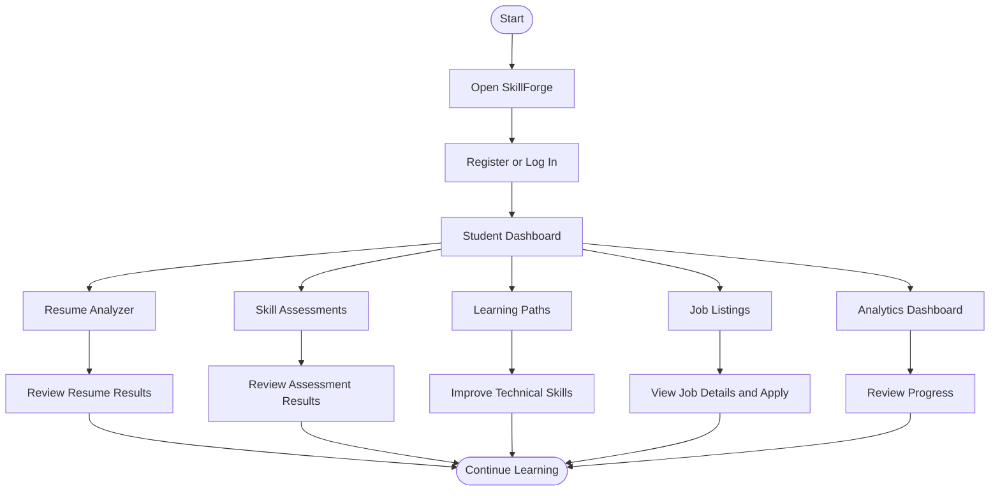

# SkillForge — Skill Development and Placement Recommendation System

SkillForge is a MERN stack web application designed to help students develop technical skills and prepare for placement opportunities. It combines resume analysis, skill assessments, learning resources, job listings, and progress tracking in one platform.

The goal is to help students identify skill gaps, improve their technical abilities, explore learning opportunities, and discover relevant job openings.

## 🚀 Live Demo

| Resource | Link |
|---|---|
| **Live Application** | [Open SkillForge](https://skill-placement-system-1.onrender.com/) |
| **GitHub Repository** | [View Source Code](#) |

## ✨ Key Features

### 1. Resume Analyzer
- Upload and analyze resumes.
- Extract relevant information, including skills and project details.
- Review resume analysis results and improvement suggestions.

### 2. Skill Assessments
- Evaluate technical knowledge.
- Identify areas for improvement.
- Review assessment results.

### 3. Learning Paths
- Explore learning resources to improve technical skills.
- Follow available learning recommendations.
- Track learning progress where supported by the application.

### 4. Job Listings
- Browse job opportunities.
- View job details and application links.
- Explore relevant career opportunities.

### 5. Student Dashboard
- Access the application's main features from one place.
- Navigate between resume, learning, assessment, and job features.

### 6. Analytics Dashboard
- Review available skill development information.
- View learning and progress-related analytics.

## 🛠️ Technologies Used

| Category | Technologies |
|---|---|
| Frontend | React.js, JavaScript, HTML5, CSS3 |
| Routing and API Requests | React Router, Axios |
| Backend | Node.js, Express.js, REST APIs |
| Database | MongoDB Atlas |
| ODM | Mongoose |
| Development Tools | Code0, Visual Studio Code, Git, GitHub, npm |
| Deployment | Render |

## 📁 Project Structure

```text
skill-placement-system/
│
├── backend/
│   ├── middleware/
│   │   ├── auth.middleware.js
│   │   ├── upload.middleware.js
│   │   └── validation.middleware.js
│   │
│   ├── models/
│   │   ├── Assessment.js
│   │   ├── Course.js
│   │   ├── Feedback.js
│   │   ├── index.js
│   │   ├── Job.js
│   │   ├── LearningPath.js
│   │   ├── Skill.js
│   │   └── User.js
│   │
│   ├── routes/
│   │   ├── analytics.routes.js
│   │   ├── assessment.routes.js
│   │   ├── auth.routes.js
│   │   ├── course.routes.js
│   │   ├── feedback.routes.js
│   │   ├── job.routes.js
│   │   ├── learningPath.routes.js
│   │   ├── recommendation.routes.js
│   │   ├── resume.routes.js
│   │   ├── skill.routes.js
│   │   └── user.routes.js
│   │
│   ├── services/
│   │   ├── analytics.service.js
│   │   ├── feedbackLoop.service.js
│   │   ├── learningPath.service.js
│   │   ├── recommendation.service.js
│   │   ├── resumeAi.service.js
│   │   ├── resumeAnalysis.service.js
│   │   ├── resumeParser.service.js
│   │   └── skillGap.service.js
│   │
│   ├── tests/
│   │   ├── fixtures/
│   │   └── resumeAnalyzer.test.js
│   │
│   ├── uploads/
│   │   └── resumes/
│   ├── .env
│   ├── package.json
│   ├── package-lock.json
│   ├── seedDatabase.js
│   └── server.js
│
├── frontend/
│   ├── public/
│   ├── src/
│   │   ├── components/
│   │   │   ├── auth/
│   │   │   │   └── ProtectedRoute.jsx
│   │   │   └── layout/
│   │   │       └── Layout.jsx
│   │   │
│   │   ├── pages/
│   │   │   ├── Analytics.jsx
│   │   │   ├── Assessments.jsx
│   │   │   ├── Courses.jsx
│   │   │   ├── Dashboard.jsx
│   │   │   ├── JobDetail.jsx
│   │   │   ├── Jobs.jsx
│   │   │   ├── LandingPage.jsx
│   │   │   ├── LearningPath.jsx
│   │   │   ├── LoginPage.jsx
│   │   │   ├── Profile.jsx
│   │   │   ├── RegisterPage.jsx
│   │   │   └── ResumeAnalyzer.jsx
│   │   │
│   │   ├── store/
│   │   │   ├── assessmentStore.js
│   │   │   ├── authStore.js
│   │   │   └── courseStore.js
│   │   │
│   │   ├── utils/
│   │   │   └── api.js
│   │   ├── App.js
│   │   ├── index.css
│   │   └── index.js
│   │
│   ├── .env.development
│   ├── .env.production
│   ├── package.json
│   └── package-lock.json
│
├── .gitignore
└── README.md
```

## 🔄 Application Workflow



## 📋 Prerequisites

Before running SkillForge locally, install:

- [Node.js and npm](https://nodejs.org/)
- [Git](https://git-scm.com/)
- A MongoDB Atlas account or another configured MongoDB instance
- Visual Studio Code (recommended)

## ⚙️ Installation and Setup

### Step 1: Clone the repository

```bash
git clone https://github.com/skillforge/skill-placement-system.git
cd skill-placement-system
```

### Step 2: Install backend dependencies

```bash
cd backend
npm install
```

### Step 3: Configure environment variables

Create the backend environment file required by the application. Configure the MongoDB connection string, port, and any other required settings.

Example configuration:

```env
PORT=5000
MONGODB_URI=your_mongodb_connection_string
NODE_ENV=development
```

Use the exact variable names expected by your backend code. Additional settings, such as authentication secrets and the Gemini API key, may be required for particular features.

**Security:** Never commit passwords, database credentials, JWT secrets, API keys, or other sensitive values to GitHub.

### Step 4: Start the backend

From the `backend` directory, run:

```bash
npm run dev
```

Alternatively, if the development script is not configured:

```bash
npm start
```

Keep the backend terminal running.

### Step 5: Install frontend dependencies

Open a second terminal and navigate to the project root, then run:

```bash
cd frontend
npm install
```

Configure the frontend API URL using the environment variable expected by your application.

For the deployed environment, the backend URL is:

`https://skill-placement-system.onrender.com`

### Step 6: Start the frontend

From the `frontend` directory, run:

```bash
npm start
```

Open the local URL displayed in the terminal.

### Step 7: Create a production build

From the project root, run:

```bash
npm --prefix frontend run build
```

The optimized production files will be generated in the `frontend/build` directory.

## 🧪 Testing

### Backend tests

```bash
npm --prefix backend test
```

### Frontend tests

```bash
npm --prefix frontend test
```

### Production build verification

```bash
npm --prefix frontend run build
```

Run the commands supported by your package scripts and review the output for errors or warnings.

## 🌐 Deployment on Render

SkillForge is optimized for seamless deployment on **Render** (as a Node.js Web Service for the backend and a Static Site for the frontend).

### Architecture Overview

```text
React SPA (Render Static Site)
  │
  ├─── Rewrites: /* -> /index.html (via _redirects)
  │
  └─── API Calls (CORS enabled)
         │
         ▼
Node.js / Express API (Render Web Service)
  │
  ├─── Auto-seeds default role accounts on connect
  └─── Connects to MongoDB Atlas Cloud Database
```

### 1. Backend Deployment (Render Web Service)
1. In Render Dashboard, click **New +** > **Web Service**.
2. Connect your GitHub repository: `skill-placement-system`.
3. Configure the following settings:
   - **Name**: `skill-placement-backend`
   - **Root Directory**: `backend`
   - **Environment**: `Node`
   - **Build Command**: `npm install`
   - **Start Command**: `npm start`
   - **Health Check Path**: `/api/health`
4. Add the following **Environment Variables**:
   | Variable | Value / Description |
   |---|---|
   | `NODE_ENV` | `production` |
   | `PORT` | `5000` |
   | `MONGODB_URI` | Your MongoDB Atlas connection string (e.g. `mongodb+srv://...`) |
   | `JWT_SECRET` | A secure random 32+ character string |
   | `FRONTEND_URL` | Your frontend Render URL (e.g. `https://skill-placement-frontend.onrender.com`) |
   | `GEMINI_API_KEY` | *(Optional)* Your Google Gemini API Key for AI resume parsing |
   | `RESUME_AI_MODEL` | `gemini-3.8-flash` |

### 2. Frontend Deployment (Render Static Site)
1. In Render Dashboard, click **New +** > **Static Site**.
2. Connect your GitHub repository: `skill-placement-system`.
3. Configure the following settings:
   - **Name**: `skill-placement-frontend`
   - **Root Directory**: `frontend`
   - **Build Command**: `npm install && npm run build`
   - **Publish Directory**: `build`
4. Add the following **Environment Variables**:
   | Variable | Value / Description |
   |---|---|
   | `REACT_APP_API_URL` | `https://<your-backend-slug>.onrender.com/api` |
   | `GENERATE_SOURCEMAP` | `false` |
5. **SPA Routing**: Handled automatically via `public/_redirects` (`/* /index.html 200`) and `render.yaml`. All client-side routes (dashboard, recruiter, admin) will reload cleanly without 404s.

### 3. Automated Deployment via Render Blueprint (`render.yaml`)
Alternatively, deploy both services together in 1 click using Render Blueprints:
1. In Render Dashboard, click **New +** > **Blueprint**.
2. Select your repository. Render will automatically detect `render.yaml` and configure both the backend service and frontend static site with all build parameters, health check, and rewrites.

### 🔐 Default Pre-configured Role Accounts

On initial connection to MongoDB, the backend automatically ensures the following accounts exist:

| Role | Email | Password | Access Portal |
|---|---|---|---|
| **Admin** | `admin@skillforge.com` | `admin123` | `/admin/login` & `/admin/*` |
| **Recruiter** | `recruiter@skillforge.com` | `recruiter123` | `/recruiter/login` & `/recruiter/*` |
| **College Admin** | `college@skillforge.com` | `college123` | `/login` |
| **Student** | `student@skillforge.com` | `student123` | `/login` & Student Dashboard |

## 🤖 Code0 Development Workflow

Code0 was used during the development of SkillForge as part of an AI-assisted development workflow.

It supported selected implementation, debugging, refactoring, and testing tasks. Generated suggestions were reviewed against the application's expected behavior, and changes were validated through code review and testing where appropriate.

Git and GitHub were used to track changes, maintain commit history, and host the project for review.

## 🧠 AI Development Experience

AI-assisted development helped investigate technical issues, review code changes, and improve selected parts of the application. Code0 supported work across frontend components, backend logic, API data flow, and testing.

### Specific Tasks Where Code0 Helped

1. **Frontend Component Development:** Investigated resume analyzer rendering and mapping extracted project information to frontend components.
2. **Backend Logic and Validation:** Reviewed resume analysis logic and validation behavior.
3. **Debugging:** Investigated the TCS Software Engineer application link used by the Jobs page.
4. **API and Database Integration:** Traced job data returned by the backend and verified the updated job website URL in MongoDB Atlas.
5. **Testing and Refactoring:** Updated resume analyzer test cases and regression coverage for project extraction behavior.

These examples describe tasks performed during development. The implementation and validation approach can be explained further during a technical interview.

## 🔧 Git and GitHub Practices

- Used Git to track source-code changes and maintain commit history.
- Hosted the project in a public GitHub repository.
- Used Code0's terminal for Git operations during development.
- Reviewed changes before committing and pushing them.
- Kept sensitive configuration values out of version control.

## 🔮 Future Enhancements

- Improve personalized learning recommendations.
- Expand job matching and skill gap analysis.
- Add more technical assessment categories.
- Enhance progress reporting and data visualization.
- Improve the overall user experience and responsiveness.

## 👥 Team

**SkillForge Core Platform Team**

**Project:** SkillForge — Skill Development and Placement Recommendation System
